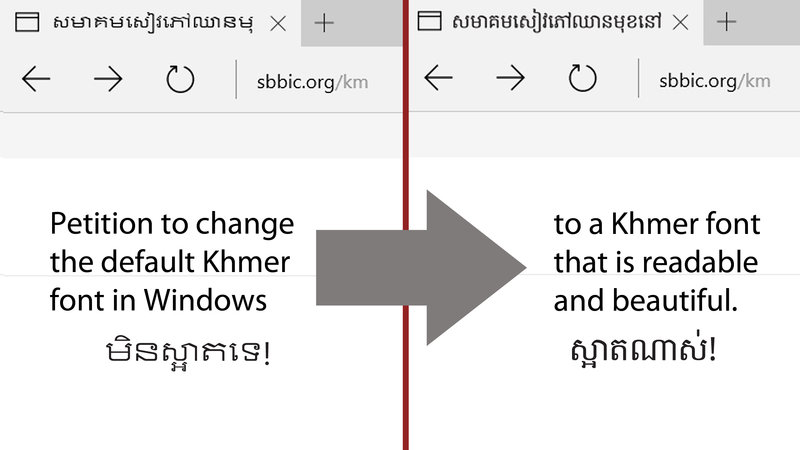

# Khmer System Fonts for Windows 10



This project aims to replace the ugly Khmer UI fonts provided by Microsoft as the default Khmer System fonts in Windows 10.

## Directories

``backup`` stores original Khmer fonts for Windows 10.

``dist`` stores packages ready for distribution.

``var`` stores fonts in development.

## Install

1. Get a package from ``dist`` directory or from [releases](https://github.com/fidele007/Khmer-System-Fonts-Win10/releases)
1. Unzip the downloaded package
1. Select all fonts
1. Right-click, choose **Install for all users** and replace the existing fonts
1. Restart your computer

## Uninstall

Install and overwrite all fonts in ``backup`` directory

## Customize the Khmer glyphs

The project includes a reusable converter for making customized Windows
system fonts. It replaces the Khmer subsystem with the Khmer glyphs and
shaping data from a font you choose, while preserving the original system
font's internal names. It can also enlarge Khmer glyphs relative to Latin
text.

See the complete end-user guide in
[`tools/README.md`](tools/README.md).

### Quick start

Install Python 3 and the `fontTools` package:

```powershell
python -m pip install fonttools
```

From an Administrator PowerShell opened at the project directory, copy the
original Windows fonts into a working directory. Do not edit the installed
files directly:

```powershell
$inputDir = Join-Path $PWD "input-windows"
New-Item -ItemType Directory -Force -Path $inputDir | Out-Null

foreach ($fontName in @(
    "LeelUIsl.ttf", "LeelaUIb.ttf", "LeelawUI.ttf",
    "KhmerUI.ttf", "KhmerUIb.ttf"
)) {
    Copy-Item -LiteralPath (Join-Path $env:WINDIR "Fonts\$fontName") `
        -Destination (Join-Path $inputDir $fontName) -Force
}
```

Convert one font by providing the original font, the replacement font, and
the output path:

```powershell
python tools\replace_khmer_font.py --scale 1.25 `
    --pair input.ttf replacement.ttf output.ttf
```

Repeat `--pair` to convert several fonts in one command. Use a scale of `1.0`
to keep the replacement font's Khmer size, or adjust it until Khmer has the
desired relationship to English text. The converter supports TrueType/OpenType
fonts with `glyf` outlines and compatible Khmer shaping data.

Before installing generated fonts, keep a backup of the originals and verify
that the output files open correctly. Select the generated files, choose
**Install for all users**, and allow Windows to replace the existing fonts.
Restart applications, or Windows if necessary, to clear the font cache. Since
the generated files intentionally retain the Windows font names, do not install
the original and generated versions side by side.

Only use replacement fonts and Windows font files according to their licenses.
Google Sans, for example, is distributed under the SIL Open Font License;
preserve its license and copyright notices when redistributing modified files.
